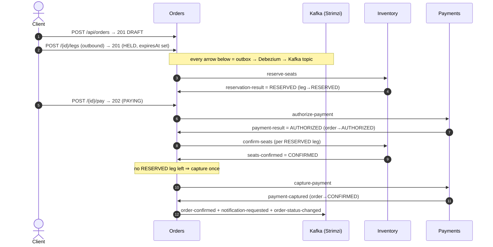
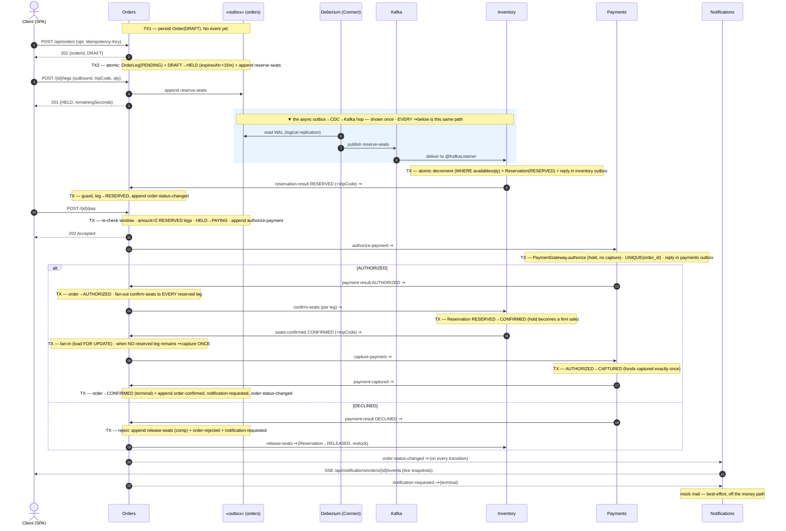

# EuroTransit Marketplace — Application repository (g03)

Source for the cooperating services, their tests, the CI workflow and the `justfile`. This is the
**application** half of a two-repository GitOps model; the **configuration** repository
(`eurotransit-platform`) holds the Helm charts, platform bootstrap, Argo CD `Application`s,
SLO/alert definitions and the team's graded `docs/`.

> CI here builds and tests images, pushes **immutable** images (tagged with the commit SHA) to ACR, and
> bumps the desired image tag in the configuration repository. **CI never holds cluster credentials** —
> Argo CD reconciles the cluster to match Git.

The system is a small, realistic train-ticket marketplace built to prove **operational behaviour under
partial failure**, not feature richness. It is graded on four pillars: **A** distributed design & async
execution, **B** consistency under contention (inventory), **C** resilience engineering, **D** delivery +
observability + proof. This README is the canonical **application-side** knowledge base (architecture,
domain, money path, implementation choices); the code is the ultimate source of truth, and each
`services/<svc>/CLAUDE.md` documents that service's domain in depth.

---

## 1. The services

| Service | Package | Role | On money path? |
|---|---|:---:|:---:|
| **catalog** | `it.g03.catalog` | Public read API for stations/trips; staleness-tolerant | no |
| **orders** | `it.g03.orders` | **Saga orchestrator** — booking lifecycle + transactional outbox | **yes** |
| **inventory** | `it.g03.inventory` | The **contended resource**: atomic seat reservation (never oversell) | **yes** |
| **payments** | `it.g03.payments` | Idempotent authorize→capture behind a `PaymentGateway` (mock / PayPal) | **yes** |
| **notifications** | `it.g03.notifications` | Fully async sink: SSE status relay + best-effort mail; degrades without failing checkout | no |
| **users** | `it.g03.users` | Buyer profile keyed by the Keycloak JWT subject | no |

North-south entry is a single Traefik ingress. Browsing (`catalog`) and the booking intake (`orders`) are
synchronous REST; the **pay → confirm → capture** half of the money path is a **fully asynchronous,
orchestrated Kafka command/reply saga** (Orders is the coordinator) — there are no cross-service HTTP calls
on the money path.

## 2. Anatomy of a service (the layers)

Every request flows top-to-bottom; a service exposes only the layers it needs.

```text
   HTTP in                     Kafka in
      │                           │
 ┌────▼───────────┐     ┌─────────▼───────────┐
 │ Controller     │     │ *CommandListeners /  │   ← EDGE (talks to the outside world)
 │ (@RestController)     │ *ReplyListeners      │
 └────┬───────────┘     │  (@KafkaListener)    │
      └───────────┬──────────────┘
            ┌──────▼──────┐
            │  Service    │   ← LOGIC (business decisions, @Transactional; appends to the outbox here)
            └──────┬──────┘
            ┌──────▼──────┐
            │ Repository  │   ← DATA (Spring Data generates the queries)
            └──────┬──────┘
            ┌──────▼──────┐
            │  Entity     │   ← the table row (@Entity)
            └─────────────┘
```

**Suffix dictionary** — open a file and you already know what it is:

| Suffix / name | Layer | What it does |
|---|---|---|
| `…Application.kt` | boot | the `main`, starts Spring (`@SpringBootApplication`) |
| `…Controller.kt` | edge (in) | receives HTTP, delegates to the Service (`@RestController`) |
| `…CommandListeners` / `…ReplyListeners` / `…Listener.kt` | edge (in) | consume Kafka commands/replies/events (`@KafkaListener`) |
| `…Service(Impl).kt` | logic | business decisions, transactions, outbox append (`interface` + `@Service` impl) |
| `…Repository.kt` | data | one interface per file; Spring Data generates queries |
| entities (`Order`, `OrderLeg`, `Reservation`, …) | data | one table row (`@Entity`) |
| `…Events.kt` / `SagaEvents.kt` (+ `object Topics`) | contract | JSON shape of Kafka messages + topic names |
| `Outbox.kt` (+ `OutboxEvent`) | reliability | append the event in the **same tx** as the state change (drained by Debezium) |
| `KafkaErrorHandler.kt` | resilience | bounded consumer retry + dead-letter (DLT) |

Layering is strict: **Controller → Service → Repository**, a controller never touches a repository directly.
Boundary types are DTOs (never expose JPA entities), request bodies are Bean-Validated, and list endpoints
are paginated (`Pageable` + `Specification`, return `Page<Dto>`).

## 3. The money path — a two-phase, human-gated booking

A **booking** is one journey: an OUTBOUND leg (required) plus an optional RETURN leg — at most two legs, each
a distinct `trip_code`. The user-driven half is synchronous REST on `/api/orders`; confirm + capture run as
the async saga. Buyer identity always comes from the validated JWT `sub`, **never** the request body.

### Synchronous intake (`orders`)

| Step | Endpoint | Effect |
|---|---|---|
| **Create draft** | `POST /api/orders` (opt. `Idempotency-Key` header) | persist `Order(status=DRAFT)`; **201**. A repeated key replays the existing order. |
| **Add leg** | `POST /api/orders/{id}/legs` `{direction, tripCode, qty}` | reserve-on-add: save `OrderLeg(PENDING)`, append **`reserve-seats`** to the outbox in the same tx; the **first** leg moves DRAFT→**HELD** and stamps `expiresAt = now + 15m` (the hold window). **201** |
| **Remove leg** | `DELETE /api/orders/{id}/legs/{legId}` | drop a leg; if none remain, HELD→DRAFT and clear `expiresAt` |
| **Pay** | `POST /api/orders/{id}/pay` | re-check the window, compute the amount over RESERVED legs, stamp `paymentInitiatedAt`, HELD→**PAYING**, append **`authorize-payment`**; **202** |

The **hold window is backend-authoritative** (`expiresAt` on the order; `remainingSeconds` is computed
server-side). The frontend countdown is display-only. `pay` refuses if any leg is still `PENDING` (reservation
still settling), if there is no `RESERVED` outbound leg, or if the window has elapsed
(`CheckoutWindowExpiredException`). Pricing is a flat `app.unit-price-cents` (default 1000) snapshotted onto
each leg at add-time — Orders deliberately does **not** call Catalog on the money path.

### Async saga (reply-driven, `OrderStateMachine`)

Each reply arrives on Kafka → the thin `OrderSaga` dispatcher → the `@Transactional` `OrderStateMachine`.
Every transition loads the aggregate, **guards on the current status**, mutates it, and appends the next
command/terminal event to the outbox **atomically** (state + event commit or roll back together).

```text
DRAFT ──add first leg (reserve-on-add, stamp expiresAt)──▶ HELD
HELD  ──add/remove legs──▶ HELD ;  empty again ──▶ DRAFT (clear expiresAt)
HELD  ──pay (in window)──▶ PAYING
PAYING ──payment-result AUTHORIZED──▶ AUTHORIZED   [fan out confirm-seats to every RESERVED leg]
PAYING ──payment-result DECLINED────▶ REJECTED(PAYMENT_DECLINED)      [release held legs]
AUTHORIZED ──all legs seats-confirmed──▶ capture-payment ──payment-captured──▶ CONFIRMED  (terminal)
AUTHORIZED ──a leg seats-confirmed EXPIRED──▶ REJECTED(RESERVATION_EXPIRED)  [release legs + cancel-authorization]
HELD / PAYING ──checkout window elapses──▶ REJECTED(EXPIRED_NO_PAYMENT | SERVICE_UNAVAILABLE)
```

- **Order states**: `DRAFT, HELD, PAYING, AUTHORIZED, CONFIRMED, REJECTED`. **Leg states**: `PENDING,
  RESERVED, SOLD_OUT, CONFIRMED, EXPIRED, RELEASED`.
- **Multi-leg fan-out / fan-in**: `reservation-result` and `seats-confirmed` replies carry the `tripCode`, so
  each reply maps to exactly one leg (`findByOrderIdAndTripCode`); `capture-payment` fires **once**, when no
  `RESERVED` leg remains (the `seats-confirmed` fan-in loads the order `FOR UPDATE`). A `SOLD_OUT` **return**
  leg degrades to a one-way booking (the order stays HELD) rather than failing the whole booking.
- **Capture-last**: funds are only *held* at authorize and captured only after every leg is firmly confirmed,
  so an expired hold cancels the authorization — no money moved, no refund needed.
- **Compensations** (`reject`): release every RESERVED/CONFIRMED leg (→ RELEASED) and optionally
  `cancel-authorization`; idempotent (no-op if already REJECTED). Terminal transitions emit `order-confirmed`
  / `order-rejected` + `notification-requested`.

### Command / reply contracts (Kafka topics)

| Direction | Topics |
|---|---|
| commands → inventory / payments | `reserve-seats`, `authorize-payment`, `confirm-seats`, `capture-payment`, `release-seats`, `cancel-authorization` |
| replies → orders | `reservation-result` (RESERVED\|SOLD_OUT, +tripCode), `payment-result` (AUTHORIZED\|DECLINED), `seats-confirmed` (CONFIRMED\|EXPIRED, +tripCode), `payment-captured` |
| terminal / notify | `order-confirmed`, `order-rejected`, `notification-requested` |
| status stream | `order-status-changed` (a per-transition booking snapshot for the SSE relay) |
| dead-letter | `orders-dlt`, `inventory-dlt`, `payments-dlt` |

The saga is triggered by the **synchronous add-leg (reserve) and pay (authorize)** — there is no
`order-placed` trigger.



### End-to-end operational trace (the outbox & the async hop made explicit)

The overview above collapses each cross-service arrow. The trace below **expands what actually happens**: every
command and reply is written to the producing service's `outbox_events` table **inside the business
transaction**, then published to Kafka by **Debezium** reading the Postgres WAL (log-based CDC) — the apps never
call each other or produce to Kafka directly. The blue band shows this hop once; afterwards `⇒` is shorthand for
"travels the same outbox → Debezium → Kafka → listener way". `TXn` marks an atomic database transaction (state
change **and** its outbox row commit or roll back together).



**Legend — operations & transactions**

- **`⇒` (async hop):** producer appends to its `outbox_events` in the business tx → Debezium reads the WAL →
  publishes to the Kafka topic → the consumer's `@KafkaListener` handles it. At-least-once delivery, so every
  handler is idempotent. The `traceparent` is carried in the outbox row → Kafka header, so one distributed trace
  spans the whole path even though Debezium (not the app) is the producer.
- **`TXn` (atomic transaction):** the business state change **and** its outbox row commit together — if the DB
  rolls back, no event is emitted (no dual-write, no ghost events). This is why the diagram pairs each state
  change with its `append`.
- **Guards & idempotency:** each `OrderStateMachine` handler guards on the current status; a duplicate/out-of-order
  reply on the wrong or terminal state is a clean no-op. `UNIQUE(order_id)` (payments) and
  `UNIQUE(order_id, trip_code)` (inventory / order legs) make a redelivery replay the stored outcome.
- **Fan-out / fan-in / capture-once:** `authorize` succeeding fans `confirm-seats` out to every RESERVED leg;
  the `seats-confirmed` replies fan back in under a `FOR UPDATE` lock and `capture-payment` fires **once**, only
  when no RESERVED leg is left.
- **Branches not drawn (to keep the trace legible):** `SOLD_OUT` on the outbound leg → `reject(SOLD_OUT)` (a
  `SOLD_OUT` *return* leg just degrades to a one-way booking); `seats-confirmed EXPIRED` after authorize →
  `reject(RESERVATION_EXPIRED)` + `cancel-authorization` (void the hold — no capture, so no refund).
- **The two sweepers (background, not shown):** `OrderTimeoutSweeper` re-drives a PAYING/AUTHORIZED order stuck
  past 2m (a lost reply) by re-emitting its current command; `CheckoutExpirySweeper` gives up on a HELD/PAYING
  order whose 15m window elapsed → `EXPIRED_NO_PAYMENT` (never paid) or `SERVICE_UNAVAILABLE` (paid, pipeline
  stalled) + `cancel-authorization`.

### The two timers (both `@Scheduled`, poll ~5s)

- **`OrderTimeoutSweeper`** — *recover within the window.* Re-drives orders stuck in PAYING/AUTHORIZED past a
  deadline (2m) by re-emitting the command for the current state (idempotent downstream). Publishes the gauge
  `orders_overdue_nonterminal`. **DRAFT/HELD are never re-driven** — they wait for the user.
- **`CheckoutExpirySweeper`** — *give up at the window.* Expires HELD/PAYING orders whose `expiresAt` elapsed.
  Dual-cause on `paymentInitiatedAt`: null ⇒ `EXPIRED_NO_PAYMENT` (the user never paid); non-null ⇒
  `SERVICE_UNAVAILABLE` (pay was accepted but the pipeline stalled) + `cancel-authorization`.

`@Version` on `Order` and `OrderLeg` makes a re-drive racing an in-flight reply fail at commit; `OrderSaga`
absorbs the `ObjectOptimisticLockingFailureException` as a benign no-op (the other transaction already advanced).

## 4. Correctness under contention & idempotency (Pillar B)

- **Never oversell** — reservation is an atomic conditional decrement on `trip_seats`:
  `UPDATE … SET available = available - :qty WHERE trip_code = :t AND available >= :qty`. The row lock
  serialises concurrent buyers of the last seat; the loser sees 0 rows affected = sold out. A DB
  `CHECK (available >= 0)` is the backstop. Proven by `InventoryConcurrencyTest` (N threads, 1 seat → exactly
  one winner).
- **Never double-charge / effective exactly-once** — `UNIQUE(order_id)` on `payment_authorizations` and
  `UNIQUE(order_id, trip_code)` on `reservations`/`order_legs`. Kafka's at-least-once delivery is safe because a
  redelivery replays the stored outcome instead of acting twice.
- **Idempotent transitions** — every state-machine handler guards on the current status, so a duplicate or
  out-of-order reply on the wrong/terminal state is a clean no-op (no double command, no flip of a terminal order).
- **Optimistic locking** — `@Version` on the contended aggregates; the sweeper-vs-reply race resolves by rolling
  back the loser, never by double-acting.

## 5. Payments & the pluggable gateway (Pillar B)

Payments is two-phase (**authorize = hold**, **capture = last**) behind a `PaymentGateway` interface
(`authorize` / `capture` / `void`), selected by `payments.provider`:

- **`mock`** (default) — deterministic: `amountCents < payments.decline-threshold-cents` (default 100000) →
  `AUTHORIZED`, else `DECLINED("AMOUNT_OVER_THRESHOLD")`. The demo triggers the compensation path by ordering a
  large quantity.
- **`paypal`** — PayPal **Orders v2 sandbox**, server-to-server. `PayPalTokenProvider` fetches an OAuth2
  client-credentials token (cached with a refresh margin); requests carry a `PayPal-Request-Id` for
  provider-side idempotency and are wrapped in a Resilience4j `@CircuitBreaker`/`@Retry` with bounded
  connect/read timeouts. This is the one place a synchronous external egress exists, so it is the one place a
  circuit breaker belongs.

A **decline is a business outcome**, not an exception. `UNIQUE(order_id)` is the single-charge arbiter; a
compensation that arrives before an authorize writes a **VOIDED tombstone** so the later authorize refuses
(the tombstone wins the cross-topic race). **No card data is stored or logged** — the checkout card form in
the SPA is cosmetic; `pay` is a one-click trigger and the PSP authorizes server-side.

## 6. Client status stream (SSE)

The SPA observes the saga live without polling the money path:

- Orders appends an `OrderResponse` snapshot to the outbox on **every** async transition → topic
  **`order-status-changed`**.
- `notifications` consumes it (`OrderStatusListener`) and relays it through `OrderStreamHub` — an in-memory
  `orderId → {SseEmitter}` fan-out with a 15s heartbeat and a 20-minute timeout. Because the fan-out is
  in-process, notifications runs **single-replica by design** (no shared bus); losing it just drops streams the
  client reconnects to or polls.
- Endpoint: `GET /api/notifications/orders/{orderId}/events` (`text/event-stream`, **authenticated**; ownership
  is verified by forwarding the caller's bearer to Orders).
- The frontend consumer uses `fetch` + a `ReadableStream` (not `EventSource`, which can't set the auth header)
  and **falls back to adaptive-backoff polling** of `GET /api/orders/{id}` after repeated stream drops.

`notification-requested` is a separate best-effort tail: notifications logs a mock mail line and keeps a small
in-memory ring — it degrades independently and checkout never waits on it.

## 7. Transactional outbox + Debezium CDC (Pillar A)

Every money-path service (orders, inventory, payments) owns an `outbox_events` table. Inside its
`@Transactional`, the Service appends the event/reply **in the same transaction** as the state change — if the
DB commits, the event exists; if it rolls back, it doesn't (no dual-write, no ghost events). Publishing is
**log-based CDC**: **Debezium** (Strimzi Kafka Connect, 2 replicas, one connector per service) reads the
Postgres WAL (CloudNativePG at `wal_level=logical`) and publishes to Kafka. There is **no in-app polling
relay**. A crashed service resumes by reading the topics (at-least-once + idempotent handlers).

**Tracing across the CDC hop**: because the *producer* is Debezium (not the app's `KafkaTemplate`), `Outbox`
captures the W3C `traceparent` of the current span into a column in the same transaction; Debezium's event
router maps it to a Kafka header and consumers continue the trace (`observation-enabled: true`). A null
`traceparent` (e.g. a sweeper re-drive with no active span) means the consumer starts a fresh trace — never a
fabricated one.

**Saga-completion SLI**: `orders_confirmed_total` / `orders_rejected_total{reason}` are incremented in the
terminal transitions (a rejection is a *completed* saga — SOLD_OUT/DECLINED are correct outcomes, not faults),
plus the `orders_overdue_nonterminal` gauge from the sweeper. The alert keys on the terminal-ratio and the
gauge, never on the confirmed-ratio (see the config repo's design doc §4-D).

## 8. Resilience in the code (Pillar C)

The money path is async, so its resilience comes from temporal decoupling rather than a synchronous breaker:

- **Edge load-shedding** — `@RateLimiter("orders-intake")` on `POST /api/orders` and `/pay`: over budget it
  throws `RequestNotPermitted` **before** touching the DB/outbox → **429 + Retry-After**. Controlled refusal,
  not a queue. The rate limiter is deliberately excluded from readiness.
- **Bounded retry + dead-letter** — each consumer uses `DefaultErrorHandler` + `DeadLetterPublishingRecoverer`
  with `FixedBackOff(500ms, 3)` → a per-service DLT. Offsets commit only on a clean return
  (`enable-auto-commit=false`), so a mid-handle crash is a safe redelivery and a poison message is parked, never
  head-of-line-blocking.
- **Liveness backstop** — the timeout sweeper re-drives stuck sagas so every booking reaches a terminal state in
  bounded time even if a Kafka reply is lost after its offset committed.
- **The circuit breaker returns only around a real external sync egress** — the PayPal PSP (§5). The retired
  synchronous Orders→Payments breaker/bulkhead/retry no longer exist (there is no such sync call).

Kubernetes-level resilience (probes, PDBs, HPA, topology spread, PriorityClasses, right-sizing on the
memory-tight student pool) lives in the configuration repo.

## 9. Database schema (Postgres, schema-per-service)

PostgreSQL is the only datasource — local, test, and cluster. Flyway owns the schema
(`db/migration/V*__*.sql`, scoped per service); Hibernate runs `ddl-auto: validate` only. In dev/cluster one
`eurotransit` database holds a schema per service (clean ownership, splits cleanly to dedicated CNPG clusters
for the money path in prod).

```
schema catalog        → stations, trips
schema orders         → orders, order_legs, outbox_events
schema inventory      → trip_seats, reservations, outbox_events
schema payments       → payment_authorizations, outbox_events
schema users          → user_profiles
(notifications: stateless — no schema)
```

Money-path invariants live in the schema itself: `CHECK (available >= 0)`, `UNIQUE(order_id)` (payments),
`UNIQUE(order_id, trip_code)` (inventory & order legs), plus each service's Debezium publication + heartbeat
migrations. No card/PII columns anywhere.

## 10. Stack

- **Kotlin 2.2.x**, **Spring Boot 4.0.x**, Gradle (Kotlin DSL), **JDK 21**. Spring MVC, Spring Data JPA,
  Jackson 3 (`tools.jackson`).
- **PostgreSQL** everywhere via CloudNativePG; **Flyway** owns the schema. **Testcontainers Postgres** in tests
  (no H2 anywhere).
- **Kafka** via `spring-kafka` (idempotent producer, `acks=all`, manual offset commit / at-least-once);
  **Kotlin coroutines/Flows** for genuinely suspending async work (e.g. the inventory reconciler).
- **Resilience4j** only where it earns it: the edge rate limiter and the PayPal circuit breaker/retry.
- Actuator + Micrometer (Prometheus) + Micrometer Tracing → OpenTelemetry (OTLP). Actuator exposes only
  `health,info,prometheus`; readiness includes the owned DB but not Kafka; liveness is process-only.

## 11. Build, test, run

Use `just` (`just --list` for all recipes); `<svc>` ∈ `catalog orders inventory payments notifications users`.
Tests need Docker (Testcontainers spins up Postgres).

```bash
just test <svc>      # one service's tests (real Postgres via Testcontainers)
just test-all        # every service
just build <svc>     # build the runnable jar (runs tests)
just run <svc>       # run locally on :8080 (needs Postgres + Kafka reachable)
just verify <svc>    # local Definition-of-Done gate: build → test → image → container → readiness probe
just image <svc>     # build the container image (linux/amd64)
```

Local dev is two-tier: an inner loop (docker-compose Postgres + Kafka → `just run`) and a fidelity loop (a KIND
cluster running the config-repo charts + operators). The `cluster` profile (`SPRING_PROFILES_ACTIVE=cluster`)
layers on in-cluster hardening (quiet SQL, hidden actuator health details, ECS JSON logs); in-cluster the `DB_*`
values come from the CloudNativePG-generated secret. Config is env-var driven (`${VAR:default}`) — no Spring
Cloud Config, no `@ConfigurationProperties`; secrets reach the app only from SealedSecrets.

## 12. CI/CD & GitOps

`.github/workflows/ci.yml`: a path-filtered per-service matrix builds & tests → pushes an **immutable
SHA-tagged** image to ACR → bumps `services.<svc>.image.tag` in the **configuration repo**'s `values.yaml`.
Argo CD reconciles. **CI holds no cluster credentials**; a config-repo-scoped PAT is the only bridge. Two
progressive-delivery strategies (canary + blue/green) are demonstrated in the config repo.

## 13. Frontend

`frontend/` is the **EuroTransit storefront** — a React + TypeScript + Vite SPA (Tailwind, Redux Toolkit +
RTK Query, Axios) that exercises the money path from the browser: browse → book → pay within the hold window →
watch the saga reach a terminal state over SSE. Auth is Keycloak OAuth2 **PKCE** (public client, no secret);
the SPA mints a stable client-owned `Idempotency-Key` per checkout intent. See `frontend/CLAUDE.md`.

## 14. Hardening backlog (non-blocking)

- No SAST / dependency scan / SBOM / image signing in CI yet; no ktlint/Detekt gate.
- The GitOps tag bump pushes straight to the config repo's default branch — no PR/policy-as-code review gate.
- KEDA (autoscaling consumers on Kafka lag) and non-blocking `@RetryableTopic` retries are candidate prod-grade
  follow-ups.

## 15. References

- Infra / GitOps / observability / progressive delivery, and the four-pillar infrastructure design:
  `../eurotransit-platform/README.md`.
- Phase-by-phase progress and how the team split the work:
  `../eurotransit-platform/docs/traccia/FASI_PROGETTO.md`.
- Graded record of caught agent mistakes: `../eurotransit-platform/docs/agent-log.md`.
- Per-service domain detail: each `services/<svc>/CLAUDE.md`.
</content>
</invoke>
