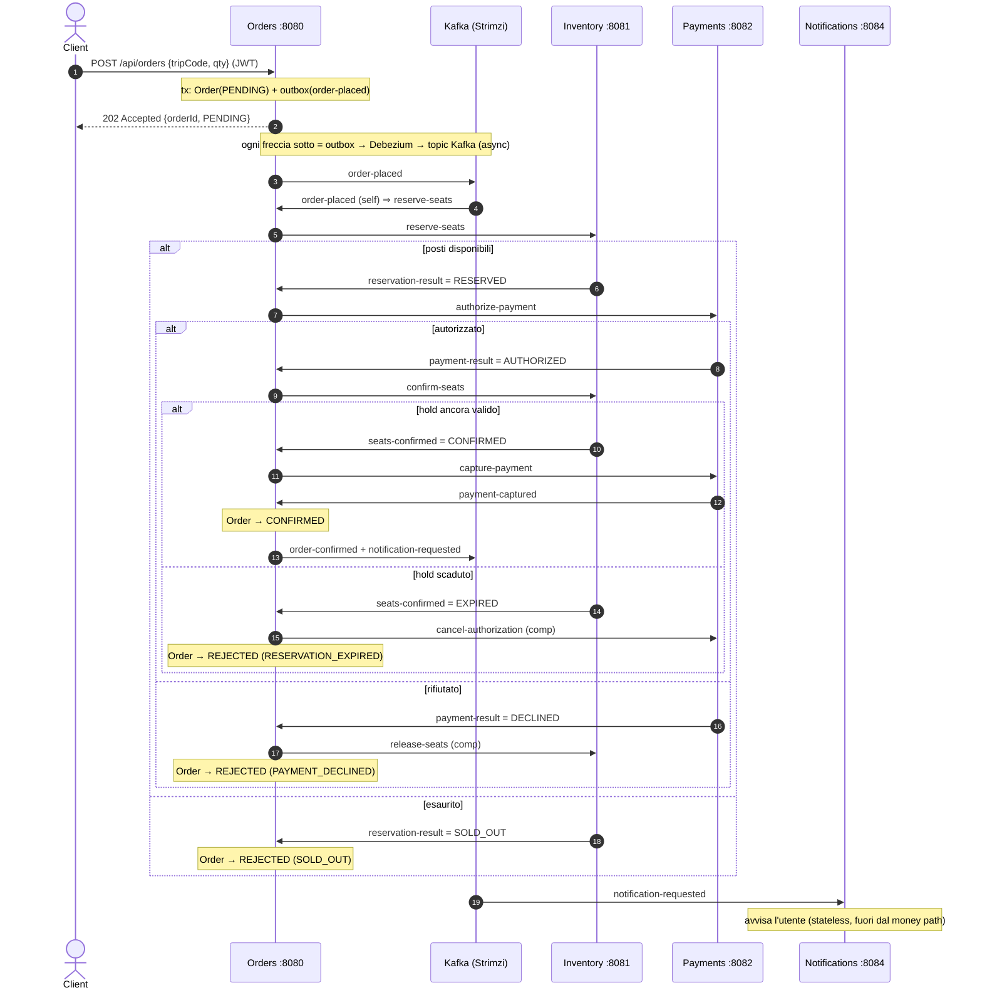

# EuroTransit — Design del codice (application repo)

> Documento **unico** e canonico del design **applicativo** (codice + dominio) di EuroTransit. Ogni scelta è
> difendibile all'orale. Si aggiorna **direttamente** quando cambia il codice (niente più file sparsi per fase).
> **Complementari:** `../capstone-configuration-g03/docs/design.md` = design **infrastruttura**/GitOps/osservabilità/delivery
> (NON duplicato qui); `docs/agent-log.md` = errori degli agenti (**gradato**); `docs/sync-vs-async-resilience.md` =
> analisi resilienza sync-vs-async (razionale del cutover); `docs/ANTIPATTERN_AUDIT.md` = audit anti-pattern.
> Fonte di verità ultima = il **codice**: se controller/listener cambiano, aggiorna questo doc.

Stack: **Kotlin 2.2 / Spring Boot 4 / JDK 21**, package root `it.g03.<service>`. Gradle multi-modulo, database-per-service
(CloudNativePG), messaging **Kafka (Strimzi)**. Il money path è **asincrono**: saga orchestrata **command/reply** su Kafka.

---

## 1. I sei servizi
| Servizio | Ruolo | Sul money path? |
|---|---|:---:|
| **catalog** | read API pubblica dei viaggi (staleness-tolerant) | no |
| **orders** | **orchestratore** della saga (state machine reply-driven) + outbox | sì |
| **inventory** | risorsa **contesa**: prenotazione atomica (never-oversell), two-phase reserve→confirm | sì |
| **payments** | autorizzazione idempotente (no double-charge), two-phase authorize→capture; PSP **mock** dietro interfaccia | sì |
| **notifications** | sink fully-async; degrada senza rompere il checkout | no |
| **users** | profili Keycloak-backed (subject del JWT) | no |

## 2. Anatomia di un servizio (gli strati)
Ogni richiesta attraversa gli strati dall'alto verso il basso. Un servizio espone **solo** gli strati che gli servono.

```text
   HTTP in                     Kafka in
      │                           │
 ┌────▼─────────┐        ┌────────▼──────────┐
 │ Controller   │        │ *CommandListeners │   ← BORDO (parla col mondo)
 │ (@RestController)      │ *ReplyListeners / │
 └────┬─────────┘        │  Listener (@KafkaListener)
      └───────────┬───────────────┘
            ┌──────▼──────┐
            │  Service    │   ← LOGICA (decisioni di business, @Transactional; qui si appende all'outbox)
            └──────┬──────┘
            ┌──────▼──────┐
            │ Repository  │   ← DATI (Spring genera le query)
            └──────┬──────┘
            ┌──────▼──────┐
            │  Entity     │   ← la riga di tabella (@Entity)
            └─────────────┘
```

**Dizionario dei suffissi** — apri un file e sai già cos'è:
| Suffisso / nome | Strato | Cosa fa | Annotazione |
|---|---|---|---|
| `…Application.kt` | Avvio | il `main`, accende Spring | `@SpringBootApplication` |
| `…Controller.kt` | Bordo (in) | riceve HTTP, delega al Service | `@RestController` |
| `…CommandListeners` / `…ReplyListeners` / `…Listener.kt` | Bordo (in) | consuma comandi/reply/eventi Kafka | `@KafkaListener` |
| `…Service.kt` | Logica | decisioni di business, transazioni, append all'outbox | `@Service`, `@Transactional` |
| `…Repository.kt` | Dati | interfaccia; Spring genera le query | `: JpaRepository<…>` |
| Entity (`Order`, `Reservation`, …) | Dati | una riga di tabella | `@Entity`, `@Table` |
| `SagaEvents.kt` / `…Events.kt` | Contratto | forma JSON dei messaggi Kafka + `object Topics` | `data class` |
| `Outbox.kt` (+ `OutboxEvent` entity, `OutboxEventRepository`) | Affidabilità | appende l'evento nella **stessa tx** dello stato (drenato da Debezium) | `@Component` |
| `KafkaErrorHandler.kt` | Resilienza | retry limitato dei consumer + dead-letter (DLT) | `@Configuration` |

> **Nota (async):** NON esiste più `Gateways.kt` (chiamate HTTP sync verso altri servizi) né un `OutboxPublisher`
> applicativo: le chiamate interne viaggiano su Kafka e la pubblicazione outbox→Kafka la fa **Debezium** (§5).

**Quali strati ha ciascun servizio:**
| Strato | catalog | orders | inventory | payments | notifications |
|---|:---:|:---:|:---:|:---:|:---:|
| Controller (HTTP in) | ✅ | ✅ (202) | — | — | (solo demo) |
| Listener (Kafka in) | — | ✅ reply + self | ✅ command | ✅ command | ✅ |
| Service (logica) | — | ✅ | ✅ | ✅ | — |
| Repository + Entity | ✅ | ✅ | ✅ | ✅ | — |
| Outbox (append + Debezium) | — | ✅ | ✅ | ✅ | — |
| Migrazioni SQL | ✅ | ✅ | ✅ | ✅ | — |

Note per servizio: **catalog** = il più semplice (Controller→Repository→Entity, niente Kafka). **notifications** = lo
specchio opposto: nessun HTTP in, nessun DB, solo un `Listener` che reagisce e può sparire senza rompere nulla.
**payments** = Service+Repository+listener dei comandi, un aggregato (`PaymentAuthorization`), regola = idempotenza.
**inventory** = due entità (`InventoryItem`, `Reservation`) + `ReservationReconciler` (background: pulisce gli hold
scaduti). **orders** = il più grande: tutti gli strati + la saga in due bean (`OrderSaga` dispatcher, `OrderStateMachine`
transazionale), i listener dei reply, l'outbox e l'`OrderTimeoutSweeper`.

## 3. Il money path — saga async Kafka command/reply
Orders accetta la POST **sincronamente con `202 Accepted`** (persistendo `Order(PENDING)` + la riga outbox `order-placed`
in **una** transazione), poi **consuma il proprio `order-placed`** ("listen-to-yourself") e avvia la saga. Da lì tutto è
**reply-driven**: Orders emette un **comando**, il servizio destinatario agisce e risponde con un **reply**; il reply fa
avanzare la state machine. Nessuna chiamata HTTP sul money path.

**Contratti (topic Kafka, creati da Strimzi lato config):**
| Direzione | Topic | Significato |
|---|---|---|
| evento | `order-placed` | trigger della saga (self-consume) |
| comando → inventory | `reserve-seats` | metti in hold i posti |
| reply ← inventory | `reservation-result` | `RESERVED` \| `SOLD_OUT` |
| comando → payments | `authorize-payment` | trattieni i fondi (solo auth, no capture) |
| reply ← payments | `payment-result` | `AUTHORIZED` \| `DECLINED` |
| comando → inventory | `confirm-seats` | trasforma l'hold in vendita ferma |
| reply ← inventory | `seats-confirmed` | `CONFIRMED` \| `EXPIRED` |
| comando → payments | `capture-payment` | cattura i fondi trattenuti (passo finale) |
| reply ← payments | `payment-captured` | fondi catturati |
| compensazione → inventory | `release-seats` | su `DECLINED`: ridai i posti |
| compensazione → payments | `cancel-authorization` | su `EXPIRED`: rilascia l'hold fondi (no capture ⇒ no rimborso) |
| evento terminale | `order-confirmed` / `order-rejected` | esito finale |
| evento (coda informativa) | `notification-requested` | dì a Notifications di avvisare l'utente |

**State machine** (`OrderStateMachine`, ogni transizione è `@Transactional`, **status-guarded** e idempotente; lo stato e
l'append del comando/evento committano — o rollbackano — insieme):

```text
PENDING ──order-placed──▶ [emette reserve-seats, resta PENDING]
  │ reservation-result
  ├─ RESERVED  ──▶ RESERVED   [emette authorize-payment]
  └─ SOLD_OUT  ──▶ REJECTED (SOLD_OUT)
RESERVED
  │ payment-result
  ├─ AUTHORIZED ─▶ AUTHORIZED [emette confirm-seats]
  └─ DECLINED  ──▶ [release-seats] + REJECTED (PAYMENT_DECLINED)
AUTHORIZED
  │ seats-confirmed
  ├─ CONFIRMED ──▶ [emette capture-payment, resta AUTHORIZED]
  └─ EXPIRED   ──▶ [cancel-authorization] + REJECTED (RESERVATION_EXPIRED)
AUTHORIZED
  │ payment-captured ──▶ CONFIRMED  [emette order-confirmed + notification-requested]   ← happy end
```

**Sequenza (happy path + rami):**


**Topologia (tutto async Kafka; ogni servizio possiede il suo DB + una outbox letta da Debezium):**
```mermaid
flowchart LR
    client([Client]) -->|/api/catalog| C["Catalog<br/>(fuori money path)"]
    client -->|/api/orders 202| O["Orders<br/>(saga orchestrator)"]
    O <-. "commands / replies" .-> K{{"Kafka (Strimzi)"}}
    I["Inventory"] <-. .-> K
    P["Payments"] <-. .-> K
    K -. "notification-requested" .-> N["Notifications<br/>(sink)"]
    C --- CDB[("catalogdb")]
    O --- ODB[("ordersdb + outbox")]
    I --- IDB[("inventorydb + outbox")]
    P --- PDB[("paymentsdb + outbox")]
    DBZ["Debezium (Kafka Connect)"] -. "legge WAL outbox" .-> ODB & IDB & PDB
    DBZ -. "pubblica" .-> K
```

**Perché è fatta così:**
- **202 + saga async** — l'utente ha subito un ack **durevole**; prenotazione/pagamento/conferma proseguono fuori dal thread di richiesta. Un `Idempotency-Key` opzionale fa sì che una POST ri-tentata **rigiochi** lo stesso ordine invece di crearne un doppio; l'identità del compratore viene dal **JWT**, mai dal body.
- **Reply-driven + listen-to-yourself** — l'ordine avanza solo su reply reali dei servizi; niente accoppiamento alla loro disponibilità istantanea (se un downstream è giù, il comando resta in coda).
- **Two-phase + compensazioni** — `reserve→confirm` e `authorize→capture` permettono compensazioni pulite: `release-seats` su pagamento `DECLINED`, `cancel-authorization` su hold `EXPIRED` (nessun capture ⇒ nessun rimborso).
- **Notifications fuori dal money path** — il checkout riesce anche se Notifications è del tutto giù.

## 4. Correttezza sotto contesa & idempotenza (Pilastro B)
- **Never-oversell** = UPDATE condizionale atomico (`available >= qty`) su `InventoryItem`: il row-lock serializza i concorrenti, il perdente vede 0 righe = sold out. Nessun lock applicativo.
- **No double-charge / exactly-once effettivo** = idempotenza con **`UNIQUE(order_id)`** (payments) e **`UNIQUE(order_id, trip_code)`** (inventory): l'at-least-once di Kafka è sicuro perché una redelivery è un no-op.
- **Transizioni idempotenti** = ogni handler della state machine **guarda lo status** prima di agire: un reply duplicato o fuori ordine su uno stato sbagliato/terminale è un no-op pulito (nessun comando doppio, nessun flip di un ordine terminale).
- **Race @Version** = optimistic locking sull'`Order`: se lo sweeper (re-drive) e un reply in volo transiscono lo stesso ordine, il perdente rollbacca con `ObjectOptimisticLockingFailureException`, che `OrderSaga` **assorbe come no-op benigno** (l'altro ha già avanzato). Ogni altra eccezione propaga all'error handler → DLT.

## 5. Outbox transazionale + Debezium CDC (Pilastro A)
Ogni servizio (orders, inventory, payments) ha una tabella **outbox**. Il `Service`, dentro la sua `@Transactional`,
appende l'evento/reply all'outbox **nella stessa transazione** dello stato: se il DB committa l'evento c'è, se rollbacca
non c'è (nessun ghost event, nessun evento perso). La pubblicazione outbox→Kafka è **Debezium CDC** (log-based): lato
config, **Strimzi Kafka Connect (3 repliche)** + un connector per servizio legge il **WAL** (CNPG in `wal_level=logical`)
e pubblica sui topic. **Niente relay applicativo a polling** — la lettura del log è il pattern prod-grade (dettaglio infra
in `../capstone-configuration-g03/docs/design.md §4-A`). Recoverability: un servizio che crasha riprende leggendo i topic
(at-least-once + handler idempotenti).

## 6. Resilienza nel codice (Pilastro C)
Col cutover async, i pattern **sincroni** Orders→Payments (circuit breaker / bulkhead / retry) sono stati **ritirati**
(non c'è più chiamata sync). La resilienza vive ora così:
- **Backpressure all'edge** — `@RateLimiter(name="orders-intake")` (resilience4j AOP) su `POST /api/orders`: entro il
  budget il body gira e ritorna 202; oltre budget lancia `RequestNotPermitted` **prima** di toccare DB/outbox →
  **429 + Retry-After** via `GlobalExceptionHandler`. Rifiuto controllato, non coda.
- **Retry limitato + dead-letter** — sui consumer: `DefaultErrorHandler` + `FixedBackOff(500ms, 3 tentativi)` +
  `DeadLetterPublishingRecoverer` → **DLT per servizio** (`orders-dlt`, `inventory-dlt`, `payments-dlt`). Offset committato
  solo su ritorno pulito (`enable-auto-commit=false`); un messaggio che continua a fallire va in DLT invece di bloccare la
  partizione (head-of-line). Bounded ⇒ niente retry-storm.
- **Liveness backstop** — `OrderTimeoutSweeper` (`@Scheduled`): un ordine non-terminale il cui `updatedAt` supera la
  deadline (reply perso: partizione Kafka, crash consumer, DLT) viene **ri-guidato** ri-emettendo il comando per il suo
  stato corrente (idempotente a valle). Ogni ordine in un proprio try/catch: uno che fallisce non blocca gli altri.
- **Dove torna il breaker** — solo attorno a un **egress esterno sincrono** (es. un PSP reale/PayPal): lì
  `@CircuitBreaker/@Retry/@TimeLimiter` (Boot 4, `resilience4j-spring-boot4` + aspectj starter). Da ri-collocare come
  bulkhead = consumer group separati + `listener.concurrency`; retry = backoff **esponenziale + jitter**; autoscaling
  consumer = **KEDA** su lag (decisione team, vedi FASI_PROGETTO Fase 2).

## 7. Riferimenti
- Infra / GitOps / osservabilità / progressive delivery: `../capstone-configuration-g03/docs/design.md`
- Avanzamento per fase: `../capstone-configuration-g03/docs/traccia/FASI_PROGETTO.md`
- Razionale del cutover sync→async: `docs/sync-vs-async-resilience.md` · Audit anti-pattern: `docs/ANTIPATTERN_AUDIT.md`
- Errori degli agenti (gradato): `docs/agent-log.md`
