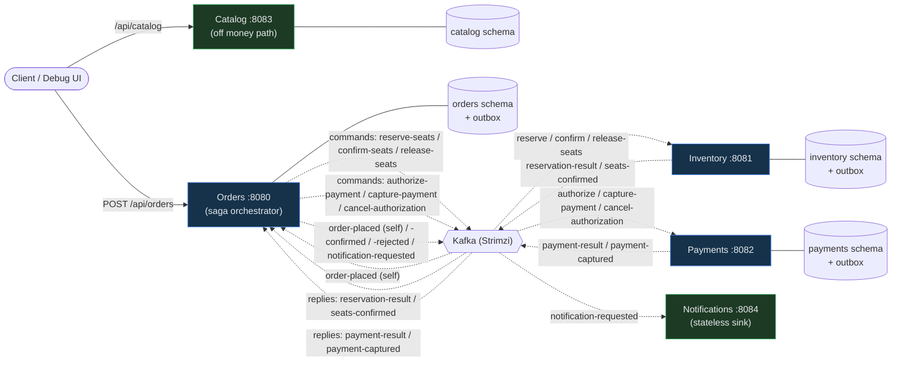

# EuroTransit — application flow

Two views of how a purchase moves through the system. The **sequence diagram** is the money path
(place-order saga); the **topology diagram** shows who talks to whom and which store each service owns.

> Source of truth is the code — if the controllers/listeners change, update these diagrams.

## Place-order saga (sequence)

Orders accepts the request **synchronously with `202`**, persisting `Order(PENDING)` plus an **outbox**
`order-placed` row in one transaction, then **consumes its own `order-placed`** to start the saga. From
there the money path is **fully asynchronous**: Orders is the orchestrator and drives Inventory and
Payments with **Kafka commands**, each of which is answered with a **Kafka reply** the producing service
emits from its **own transactional outbox** (replies are load-bearing, not best-effort). The flow is
**serial and two-phase**: phase 1 *holds* both resources (seat hold + funds authorization), phase 2
*commits* both (confirm the hold, then capture the funds) — **capture-last**, so money only ever moves
after the seat is committed. Notifications consumes only `notification-requested` and is never on the
money path.

```mermaid
sequenceDiagram
    autonumber
    actor U as Client / Debug UI
    participant O as Orders :8080
    participant K as Kafka (Strimzi)
    participant I as Inventory :8081
    participant P as Payments :8082
    participant N as Notifications :8084

    U->>O: POST /api/orders {tripCode, qty}
    Note over O: tx: save Order(PENDING) + outbox(order-placed)
    O-->>U: 202 Accepted {orderId, PENDING}
    O->>K: outbox relay publishes order-placed
    K->>O: order-placed (listen-to-yourself)
    Note over O: tx: emit reserve-seats (outbox)

    O->>K: reserve-seats
    K->>I: reserve-seats
    Note over I: tx: place hold (TTL) + emit reservation-result (outbox)
    alt seats available
        I->>K: reservation-result RESERVED
        K->>O: reservation-result RESERVED
        Note over O: PENDING -> RESERVED; emit authorize-payment
        O->>K: authorize-payment
        K->>P: authorize-payment
        Note over P: tx: AUTHORIZE (hold funds, NO capture) + emit payment-result (outbox)
        alt authorized
            P->>K: payment-result AUTHORIZED
            K->>O: payment-result AUTHORIZED
            Note over O: RESERVED -> AUTHORIZED; emit confirm-seats
            O->>K: confirm-seats
            K->>I: confirm-seats
            Note over I: tx: commit the hold + emit seats-confirmed (outbox)
            alt hold still valid
                I->>K: seats-confirmed CONFIRMED
                K->>O: seats-confirmed CONFIRMED
                Note over O: emit capture-payment
                O->>K: capture-payment
                K->>P: capture-payment
                Note over P: tx: CAPTURE held funds + emit payment-captured (outbox)
                P->>K: payment-captured
                K->>O: payment-captured
                Note over O: AUTHORIZED -> CONFIRMED
                O->>K: order-confirmed + notification-requested
            else hold expired under payment lag
                I->>K: seats-confirmed EXPIRED
                K->>O: seats-confirmed EXPIRED
                Note over O: compensate — emit cancel-authorization (release hold, no capture, no refund)
                O->>K: cancel-authorization
                Note over O: Order -> REJECTED (RESERVATION_EXPIRED)
                O->>K: order-rejected + notification-requested
            end
        else declined
            P->>K: payment-result DECLINED
            K->>O: payment-result DECLINED
            Note over O: compensate — emit release-seats
            O->>K: release-seats
            Note over O: Order -> REJECTED (PAYMENT_DECLINED)
            O->>K: order-rejected + notification-requested
        end
    else sold out
        I->>K: reservation-result SOLD_OUT
        K->>O: reservation-result SOLD_OUT
        Note over O: Order -> REJECTED (SOLD_OUT)
        O->>K: order-rejected + notification-requested
    end

    K->>N: notification-requested
    Note over N: send confirmation (stateless, off money path)
```

## Service & event topology

Every money-path arrow is **asynchronous Kafka** (dotted): there is no synchronous Orders→Inventory/Payments
call. Each service owns its own database **and its own transactional outbox** (the relay turns a committed
row into a published command/reply). Solid arrows are the only synchronous hops left: the client's REST
calls to the edge.



## Why it's shaped this way

- **202 + async saga** — the caller gets a durable acknowledgement immediately; the whole saga proceeds
  off the request thread over Kafka.
- **Transactional outbox on all three money-path services** — every command and every reply is written in
  the same transaction as the business change and published by a relay, so an event never escapes for a
  rolled-back change and a committed change never loses its event. Delivery is at-least-once → every
  handler is idempotent (`UNIQUE(order_id…)` + status guards).
- **Serial, two-phase, capture-last** — hold the seat and authorize the funds first; only after the hold is
  *committed* (`seats-confirmed CONFIRMED`) is the money *captured*. A hold that lapsed under payment lag is
  caught at `confirm-seats` (`EXPIRED`) and the funds authorization is cancelled for free — there is never a
  captured charge without a confirmed seat, and the expensive refund case cannot arise.
- **Orchestrated compensation** — `SOLD_OUT` rejects (nothing held); `DECLINED` releases the seat hold;
  `EXPIRED` cancels the funds authorization. All compensations are commands Orders emits; Inventory/Payments
  never command each other.
- **Resilience by decoupling** — a slow/down Payments grows consumer lag, not blocked Orders threads; the
  log buffers and the saga resumes on recovery. A poison/exhausted message is parked on a per-service
  dead-letter topic (`*-dlt`) rather than head-of-line-blocking the partition; a timeout sweeper re-drives a
  saga stuck in a non-terminal state past a deadline (re-drive is safe because commands are idempotent).
- **Notifications off the money path** — checkout succeeds even if notifications are entirely down.
```
