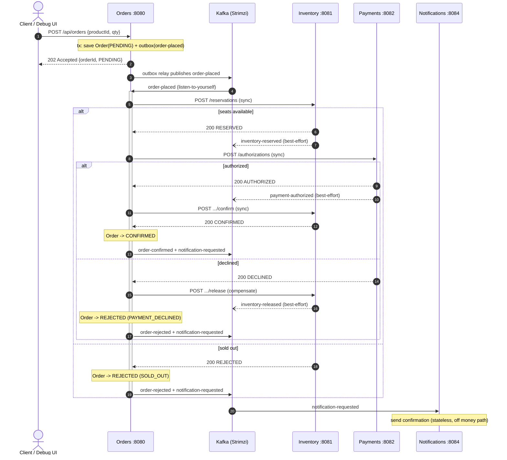
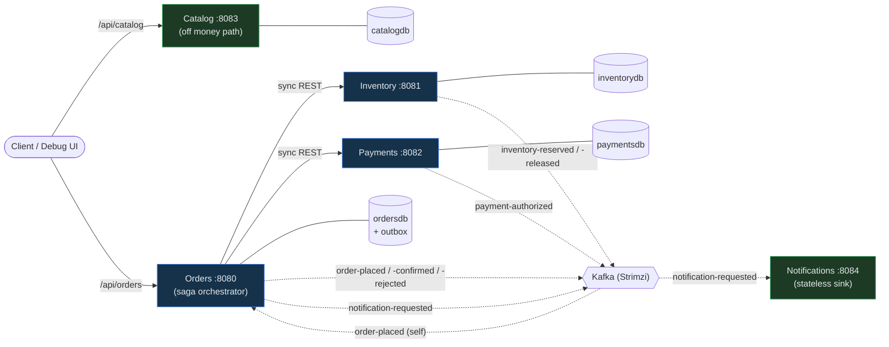

# EuroTransit — application flow

Two views of how a purchase moves through the system. The **sequence diagram** is the money path
(place-order saga); the **topology diagram** shows who talks to whom and which store each service owns.

> Source of truth is the code — if the controllers/listeners change, update these diagrams.

## Place-order saga (sequence)

Orders accepts the request **synchronously with `202`**, persisting `Order(PENDING)` plus an
**outbox** `order-placed` row in one transaction, then **consumes its own `order-placed`** to run the
saga. The branch decisions come from **synchronous REST** calls to Inventory and Payments; the
`inventory-*` / `payment-authorized` events are best-effort observability. Notifications consumes only
`notification-requested` and is never on the money path.

## Service & event topology

Solid arrows are **synchronous REST**; dotted arrows are **asynchronous Kafka** events. Each service
owns its own database (database-per-service); only Orders keeps an outbox.

## Why it's shaped this way

- **202 + async saga** — the caller gets a durable acknowledgement immediately; reservation/payment/
  confirmation proceed off the request thread.
- **Transactional outbox + listen-to-yourself** — the business row and the `order-placed` event commit
  together, so an event never escapes for a rolled-back change and a committed change never loses its event.
- **Synchronous decisions on the money path** — reserve and authorize must be answered *now*, so they're
  REST calls whose responses drive the saga branch; `SOLD_OUT` / `DECLINED` are `200` business outcomes,
  not HTTP errors (an error would trip the caller's retries/circuit breaker).
- **Compensation** — a decline after a successful reservation triggers a `release` so seats aren't leaked.
- **Best-effort events vs. load-bearing responses** — `inventory-*` / `payment-authorized` are published
  after commit for observability; correctness never depends on their delivery.
- **Notifications off the money path** — checkout succeeds even if notifications are entirely down.
